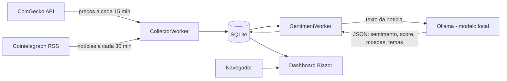

# CryptoDashboard

Dashboard em ASP.NET Core (Blazor Server) que acompanha várias criptomoedas. Ele mostra preço, variação 24h, capitalização e o sentimento das notícias de cada moeda, classificado por um modelo de linguagem local.

> Projeto de estudo. Não é recomendação de investimento. O sentimento é uma classificação automática e pode errar.

## Funcionalidades

- **Tabela de moedas:** preço, variação em 24h, capitalização, sentimento médio e número de notícias.
- **Comparativo de preço:** gráfico da variação percentual de moedas selecionadas, em 24h ou 7 dias.
- **Notícias com sentimento:** lista das notícias classificadas, com filtro por moeda.
- **Resumo de 24h:** moedas mais citadas, com positivas e negativas.

## Arquitetura



Dois workers em background rodam dentro do mesmo app:
- **CollectorWorker:** busca preços (uma chamada em lote para todas as moedas) e notícias (um feed geral e um por moeda).
- **SentimentWorker:** pega notícias ainda não classificadas, em lotes de 10, e pede ao modelo um JSON com sentimento, score, moedas citadas e temas.

## Stack

- .NET 10, ASP.NET Core Blazor Server, Tabler (interface e modo escuro)
- Entity Framework Core com SQLite (modo WAL)
- Ollama para classificação de sentimento, rodando em CPU
- Docker e Docker Compose

## Como rodar

Pré-requisito: Docker com Docker Compose.

```bash
cp .env.example .env
docker compose up -d --build
docker compose exec ollama ollama pull llama3.2
```

Abra http://localhost:8080.

O modelo precisa ser baixado uma vez. Sem ele, as notícias ficam sem sentimento e os logs mostram o erro 404 do Ollama.

Os containers voltam sozinhos após reinício, pela opção `restart: unless-stopped`, desde que o serviço do Docker esteja habilitado para iniciar com o sistema.

Para atualizar: `git pull && docker compose up -d --build`.

## Configuração

| Variável (`.env`) | Padrão | Descrição |
|---|---|---|
| `OLLAMA_MODEL` | `llama3.2` | Modelo usado na classificação. Precisa estar baixado no container |
| `OLLAMA_TIMEOUT_MINUTES` | `10` | Tempo máximo de cada chamada ao modelo. Em CPU, modelos maiores precisam de mais |

As moedas acompanhadas ficam em `src/CryptoDashboard/appsettings.json`, na chave `Coins`. Os IDs seguem o CoinGecko. A chave `NewsTags` mapeia a moeda para a tag do Cointelegraph, quando o nome for diferente.

## Observabilidade

- **Logs estruturados:** o app grava logs em JSON no stdout. Eles aparecem com `docker compose logs -f app`.
- **Rotação:** o Docker guarda no máximo 5 arquivos de 10 MB para o app, e 3 para o Ollama. Os logs não enchem o disco.
- **Health check:** `GET /health` responde `200 OK` quando o app está no ar.
- **Ciclos:** cada ciclo de coleta e de classificação registra quantos itens foram processados. O resumo de 24h é registrado a cada ciclo de classificação.

## Decisões e trade-offs

**Por que Blazor Server e não uma SPA com API separada?**
Tudo fica em C#, com um único projeto e sem camada de API para manter. A contrapartida é que cada usuário mantém uma conexão ativa com o servidor, o que dificulta escalar para várias instâncias. Para um dashboard de uso pessoal, o custo é aceitável.

**Por que SQLite e não PostgreSQL?**
O volume é pequeno, e um arquivo único com volume Docker simplifica o deploy e o backup. A contrapartida é que ele não suporta várias instâncias gravando ao mesmo tempo, e não ordena `DateTimeOffset` diretamente. Por isso o código ordena pelo `Id` e filtra datas em memória.

**Por que Ollama e não um modelo na nuvem?**
Custo zero por chamada e os dados não saem da máquina. A contrapartida é a velocidade: em CPU, cada classificação leva segundos ou minutos, e o modelo local erra mais que um modelo grande. Por isso a classificação roda em lotes a cada 30 minutos, e não em tempo real. A interface `ILlmClient` isola o provedor, então trocar de modelo exige só uma nova implementação.

**Por que coletar em lote e não por moeda?**
A CoinGecko permite pedir preços de várias moedas numa só chamada. Isso mantém o consumo baixo e evita limites de taxa, mesmo na API gratuita.

**Por que só o Cointelegraph como fonte de notícias?**
É um feed RSS público, sem chave de API, com tags por moeda. Outras fontes avaliadas tinham a API descontinuada ou restrições de acesso, como o CoinDesk. Ter só uma fonte limita a visão, e isso fica registrado como limitação.

**Como a duplicata de notícias é evitada?**
A URL é salva sem a query string, porque o mesmo artigo aparece com parâmetros `utm_*` diferentes em cada tag. Um índice único na coluna de URL garante que a regra valha mesmo em concorrência.

**Por que filtrar datas em memória?**
O SQLite compara `DateTimeOffset` como texto, e offsets diferentes quebram a comparação. Para o volume atual, carregar os registros das moedas selecionadas e filtrar em C# é simples e correto. Se o histórico crescer, a alternativa é filtrar por `Id`.

**Por que não há autenticação?**
O dashboard é somente leitura. O botão "Atualizar" só recarrega dados. Como não há ações de escrita, o risco é a exposição pública dos dados coletados, que são públicos. Se o projeto ganhar ações, autenticação passa a ser obrigatória.

**Por que não há HTTPS?**
Sem domínio e certificado, o acesso é por HTTP. O app não redireciona HTTP para HTTPS por conta própria, porque, atrás de um proxy HTTP, isso mandaria todos os acessos para um endereço que não responde. Se houver TLS na frente, o proxy faz o redirecionamento, e o app lê os cabeçalhos `X-Forwarded-*` enviados por ele.

## Limitações

- Os testes automatizados ainda não cobrem o parser do JSON nem as consultas. O funcionamento foi validado manualmente.
- A qualidade da classificação foi validada numa amostra manual pequena. Não há medição de acurácia.
- O CoinGecko gratuito tem limites de uso. A coleta faz uma chamada de preços a cada 15 minutos, mas vale acompanhar o consumo no painel da API.
- Não há alerta automático de falhas além dos logs e do endpoint `/health`.

## Fontes e atribuições

- Preços: [CoinGecko API](https://www.coingecko.com/en/api). Confira os termos de atribuição antes de publicar.
- Notícias: [Cointelegraph](https://cointelegraph.com/) via RSS.
- Interface: [Tabler](https://github.com/tabler/tabler), licença MIT.
- Modelo de linguagem: [Ollama](https://ollama.com/). O modelo tem sua própria licença.

## Licença

Definir antes de publicar.
